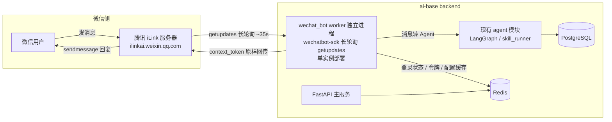

# 业界调研记录：集成微信 ClawBot（iLink）机器人服务到 ai-base 后端

## 调研问题

- 本次要解决什么问题？
  - 将微信个人号的机器人能力（微信 ClawBot / iLink Bot API）集成到 `ai-base` 项目，使微信消息可以进入项目现有的 AI Agent 处理链路，并回复到微信会话。
- 调研结果将影响哪些范围、架构、接口或实现决策？
  - 是否必须依赖 OpenClaw 运行，还是可以脱离 OpenClaw 独立接入；
  - 新增外部集成面的接入形态（独立 worker 进程 / 主进程内嵌 / 旁路网关）；
  - 新增的鉴权与令牌管理（`bot_token`、`context_token`、登录状态）；
  - 是否新增数据模型（微信消息、会话映射落库）；
  - 部署形态（docker-compose 新增服务、单实例约束）。

## 功能复杂度

- 级别：核心功能
- 选择理由：涉及新的外部平台集成面、账号级鉴权令牌管理、长轮询 worker 与现有 Agent 链路的对接，且存在安全（媒体加密、令牌存储）、生产实践（单实例轮询、断线重登）要求。
- 最低调研要求：官方/权威来源 + 成熟开源案例 + 安全与生产实践分析。

## 背景结论（先回答：必须用 OpenClaw 吗）

- 2026 年腾讯通过 OpenClaw（AI Gateway 框架）生态正式开放了微信个人账号的 Bot API，官方名称「微信 ClawBot 插件功能」，底层协议为 iLink（智联），接入域名 `ilinkai.weixin.qq.com`，有《微信 ClawBot 功能使用条款》背书，属于官方协议而非灰产逆向。
- 「开通」与「运行」是两件事：
  - 开通（获取 `bot_token`）：目前官方入口在 OpenClaw 生态（微信 ClawBot 功能扫码绑定），这一步绕不开官方入口；
  - 运行：协议是标准 HTTP/JSON，官方只给协议不给 SDK；社区已实现多语言 SDK，可直接连接腾讯官方服务器，**运行环节完全不需要 OpenClaw**。
- 因此本项目集成方式为：通过社区 Python SDK 直连腾讯 iLink 服务器，脱离 OpenClaw 运行。

## 参考依据

### 来源 1

- 类型：官方协议文档（社区 SDK 配套文档站，内容来自腾讯官方接口行为）
- 名称：微信 iLink Bot API 协议
- 链接：https://www.wechatbot.dev/zh/protocol
- 版本或发布日期：核对于 2026-08-23
- 调研日期：2026-08-23
- 核心做法：
  - 基座地址 `https://ilinkai.weixin.qq.com`，媒体 CDN `https://novac2c.cdn.weixin.qq.com/c2c`；
  - 登录为扫码模式，状态机 `wait → scaned → confirmed`（`expired` 需重新获取二维码），成功后返回 `bot_token`，后续所有请求以 `Authorization: Bearer <bot_token>` 鉴权；
  - 通用请求头固定 `AuthorizationType: ilink_bot_token`，`X-WECHAT-UIN` 为 `base64(String(randomUint32()))`，每次请求重新生成（防重放）；
  - 收消息为 `getupdates` 长轮询（非 WebSocket），服务器挂起约 35 秒；`get_updates_buf` 是不透明游标，首次传空字符串，之后必须回传最新值，否则重复收消息；
  - `context_token` 是核心概念：每条入站消息携带，回复时必须原样回传，否则无法路由到会话；按 `userId` 缓存，建议跨重启持久化；
  - 错误语义：`ret: 0` 成功；`errcode: -14` 会话过期（需清除状态并重新扫码）；`ret: -2` 参数错误；HTTP 4xx/5xx 按认证失败/服务端错误处理；
  - 输入状态指示：先 `getconfig` 取 `typing_ticket`（有效期约 24 小时），再 `sendtyping`（`status: 1` 开始、`2` 停止）；
  - 媒体（图片/视频/文件/语音）上传前用 AES-128-ECB + PKCS7 加密后走 CDN，密钥支持三种编码格式；
  - 接口清单：`get_bot_qrcode`、`get_qrcode_status`、`getupdates`、`sendmessage`、`getconfig`、`sendtyping`、`getuploadurl`、CDN `upload/download`。
- 对本项目的启发：接入本质是「一个扫码登录 + 长轮询 + 回传游标/令牌」的 HTTP 客户端，工程上适合做成独立常驻 worker，且必须由 SDK 或自研代码妥善处理 `context_token`、`get_updates_buf` 与 `-14` 重登。

### 来源 2

- 类型：成熟开源项目配套官方文档
- 名称：wechatbot.dev - Python SDK
- 链接：https://www.wechatbot.dev/zh/python
- 版本或发布日期：核对于 2026-08-23（SDK 2026-03 发布，持续迭代）
- 调研日期：2026-08-23
- 核心做法：
  - Python SDK 基于 aiohttp + asyncio，异步优先，要求 Python ≥ 3.9；
  - 装饰器风格消息处理器（类似 python-telegram-bot），dataclass 消息类型，自带 30 个测试；
  - 错误层次：`WeChatBotError → ApiError / AuthError / NoContextError / MediaError`；
  - 安装：`pip install wechatbot-sdk`；最小示例为 `bot.run()` 扫码登录后 `@bot.on_message` 处理消息、`bot.reply(msg, text)` 回复。
- 对本项目的启发：SDK 已封装游标、`context_token`、`-14` 自动重登、媒体加解密，本项目只需关注「消息进来之后如何接 Agent」，复杂度可控。

### 来源 3

- 类型：逆向解析 / 协议还原（权威社区分析）
- 名称：hao-ji-xing/openclaw-weixin - weixin-bot-api.md
- 链接：https://github.com/hao-ji-xing/openclaw-weixin/blob/main/weixin-bot-api.md
- 版本或发布日期：2026-03-21 发布
- 调研日期：2026-08-23
- 核心做法：通过逆向分析 `@tencent-weixin/openclaw-weixin` 源码，完整还原 iLink Bot 协议技术细节，并给出可运行的裸调 Demo；确认协议为标准 HTTP/JSON，无需 SDK 可直接调用；指出开通入口在 OpenClaw 生态、运行协议公开。
- 对本项目的启发：即使 SDK 失效或需要深度定制，也可以基于该文档用 `httpx` 裸调协议兜底；同时确认「脱离 OpenClaw 运行」可行。

### 来源 4

- 类型：成熟开源项目
- 名称：corespeed-io/wechatbot（微信 iLink Bot SDK，支持 Node.js / Python / Go / Rust）
- 链接：https://github.com/corespeed-io/wechatbot
- 版本或发布日期：2026-03-23 自荐发布（阮一峰科技爱好者周刊 Issue #9369、V2EX 帖）
- 调研日期：2026-08-23
- 核心做法：`pip install wechatbot-sdk`（Python）、`npm install @wechatbot/wechatbot`（Node.js）、`go get github.com/corespeed-io/wechatbot/golang`（Go）、`cargo add wechatbot`（Rust）；所有 SDK 遵循 Telegraf（中间件）、Discord.js（EventEmitter）、python-telegram-bot（装饰器处理器）等成熟设计模式；SDK 自动处理 `context_token`、`-14` 重登与媒体加解密。
- 对本项目的启发：社区生态已有多语言实现且设计模式成熟，Python 实现与本项目后端技术栈（Python 3.12 + asyncio）匹配；选型时优先采用该 SDK 而非自研协议层。

### 来源 5

- 类型：生产实践 / 社区反馈
- 名称：V2EX「微信正式开放 AI Agent 接入了，我做了一套开源 SDK」讨论帖
- 链接：https://global.v2ex.co/t/1200832
- 版本或发布日期：2026-03-23
- 调研日期：2026-08-23
- 核心做法与反馈：作者公布 SDK 与文档；社区讨论确认协议级限制：Bot 不能主动发起消息（仅能回复 24 小时内主动发过消息的人）、不支持 Markdown 渲染、不支持流式输出、部分客户端提示「版本不支持」、无历史消息 API、速率限制未公开。
- 对本项目的启发：MVP 能力边界必须按「被动回复 + 文本为主」设计；不能依赖主动推送和 Markdown 渲染，需要在 spec 阶段明确并管理用户预期。

## 方案比较

| 方案 | 优点 | 限制 | 与本项目的匹配度 |
|---|---|---|---|
| A. 社区 Python SDK（`wechatbot-sdk`）+ 后端独立 asyncio worker | 协议细节（游标、context_token、-14 重登、媒体 AES）由 SDK 封装，成熟且有测试；与 Python 3.12 / aiohttp 技术栈匹配；代码量小 | 依赖社区维护节奏，需跟进 SDK 升级；单账号同一时刻只能一个实例轮询 | 高：与 `apps/backend` 现有模块结构（如 `app/modules/agent`、`skill_runner`）天然衔接 |
| B. 自研裸协议客户端（`httpx` 直连 iLink，参考 weixin-bot-api.md） | 零第三方依赖；完全可控，可深度定制；协议文档公开 | 需自行实现游标、context_token 缓存与持久化、-14 重登、typing、媒体加解密，工作量大且易踩坑 | 中：作为 A 失效/深度定制时的兜底方案 |
| C. 运行官方 OpenClaw 网关，消息经其转发到本项目 | 跟随官方生态升级，官方兜底 | 需部署并维护 OpenClaw 网关；消息多一跳；二次集成面大；与用户「脱离 OpenClaw」的诉求冲突 | 低：仅开通阶段依赖，运行阶段不需要 |
| D. 中间 HTTP API 推送服务（如社区 weixin-bot 类小体量服务） | 部署极小，提供 HTTP API，接入简单 | 消息链路多一跳；功能面窄（以推送为主）；额外依赖第三方服务稳定性 | 低：作为演示可行，不作为正式方案 |

## 最终决策

- 选择方案：A（社区 Python SDK `wechatbot-sdk` + 后端独立 asyncio worker 进程），协议层封装在 SDK 内，保留方案 B 裸协议作为深度定制兜底。
- 选择原因：
  - SDK 已封装全部协议难点（`get_updates_buf` 游标、`context_token` 回传、`-14` 自动重登、媒体 AES-128-ECB 加解密、typing 流程），并有 30 个测试，风险可控；
  - 技术栈匹配：项目后端为 Python 3.12 + FastAPI + Celery，SDK 要求 Python ≥ 3.9 且为 asyncio 异步模型；
  - 满足用户诉求：运行环节完全不依赖 OpenClaw，仅开通（扫码获取 `bot_token`）走官方入口。
- 不选择其他方案的原因：
  - B：协议细节多、实现成本高，仅在 SDK 无法满足定制需求时启用；
  - C：运行阶段引入 OpenClaw 增加部署与链路复杂度，违背「集成到本项目」的目标；
  - D：多一跳中间服务，稳定性和功能面都不如直连 SDK。
- 对后续 spec、plan 或人工确认的影响：
  - 触发人工确认（架构边界变化 + 鉴权行为变化）：
    - 新增外部集成模块 `app/modules/wechat_bot` 与独立 worker 进程；
    - 新增账号级令牌管理（`bot_token`、`context_token`、登录二维码状态）的存储与刷新策略；
    - 若消息/会话需要落库，将新增数据模型（需再次确认）。
  - spec 阶段需用户确认的边界：
    1. Bot 行为：仅转发到现有默认 Agent 对话，还是独立配置的微信 Agent；
    2. 账号规模：单账号 MVP 还是多账号；
    3. 是否落库：微信消息是否需要持久化到 PostgreSQL；
    4. 部署形态：docker-compose 新增 `wechat-bot-worker` 服务（单实例）。

## 推荐架构（待 spec 确认）

关键设计约束（来自协议层，spec 必须遵守）：

- 单账号同一时刻只能有一个实例在轮询 `getupdates`（`get_updates_buf` 游标互相覆盖会导致丢消息/重复收），worker 必须单实例部署或用分布式锁保证；
- 回复必须回传 `context_token`（SDK 的 `reply()` 自动处理）；
- 收到 `errcode: -14` 表示会话过期，需要清除状态并重新扫码登录；
- Bot 只能被动回复（对方 24 小时内主动发过消息），不能主动发起会话；
- 不支持 Markdown 渲染与流式输出，回复以纯文本为主；
- `bot_token` 属于账号级敏感凭证，必须走环境变量/密钥管理，不得入库或入日志。

## 剩余风险

- 资料时效性：iLink 协议于 2026-03 由社区逆向整理，SDK 迭代较快；协议行为（如超时、错误码、限流）可能随腾讯侧调整，实现阶段需用真实账号扫码验证。
- 与本项目上下文的差异：`wechatbot-sdk` 未在 Python 3.12 + 本仓库依赖环境下实测过；与现有 Agent 会话模块（`app/modules/conversation`、`agent`）的消息格式映射需在 spec/实现阶段确认。
- 尚未验证的假设：开通微信 ClawBot 的账号准入条件（个人号是否全部开放、是否需要特定入口）尚未实测；腾讯保留限速、拦截与终止权利，长期可用性存在平台侧风险。
- 合规边界：以《微信 ClawBot 功能使用条款》为准，不得超出官方开放范围（如主动营销、批量外呼）。

